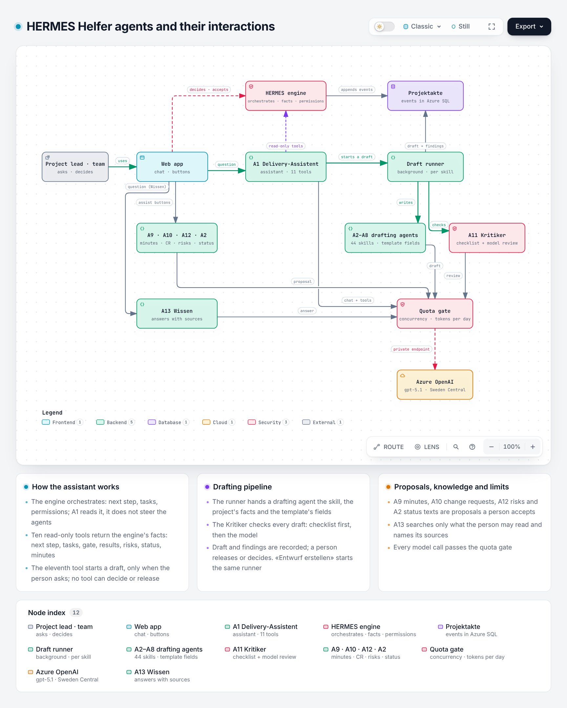

# The agents of HERMES Helfer

How the agents are built, how they are tested, which platform suits them on Azure, and how to carry them into another version of HERMES Helfer. Status: 21 October 2026.

Interactive versions, with every box linked to its code: [agents](diagrams/agents.html), [system architecture](diagrams/architecture.html) (drawn with [archify](https://github.com/tt-a1i/archify); sources in `docs/diagrams/*.archify.json`).

## 1. Which agents exist

The target architecture names 13 agents (`packages/core/src/model/agents.ts`). All of them work today.

| Agent | What it does | Started by | Code |
|---|---|---|---|
| A1 Delivery-Assistent | Answers questions about the project. The model picks among eleven tools: ten read the engine's facts (next step, tasks, gate, results, change requests, risks, status report, minutes …), one starts a draft when the person asks for it. It never decides. | Chat in the web app | `apps/api/src/agents/orchestrator.ts` |
| A2 to A8 drafting agents | Draft the results of 44 skills (Projektauftrag, ISDS-Konzept, Testkonzept …), along the organisation's Word template where one exists. A2 also drafts the texts of a status report. | «Entwurf erstellen», or A1 | `runner.ts`, `prompts.ts`, `status-report-agent.ts` |
| A10 Change-Request | Turns a rough wish into a change request and says which areas it touches. Never estimates effort or cost. | «Mit dem Agenten ausarbeiten» | `change-request-agent.ts` |
| A11 Kritiker | Checks every draft: a deterministic checklist first, then the model's content review. Also checks change requests and status texts. | Automatically, after each draft | `kritiker.ts` |
| A12 Risiko | Proposes new risks and new assessments, each resting on a fact the engine supplied. | «Risiken prüfen lassen» | `risk-agent.ts` |
| A9 Protokoll | Turns the notes or the transcript of a meeting into decisions, action items (who, what, by when) and open questions. Each item carries its passage of the text, which code checks; items without one are dropped. A member accepts each item; open action items go to their owner's tasks. The text itself is not stored. | «Protokoll erfassen» in the tab «Protokolle» | `minutes-agent.ts` |
| A13 Wissen | Answers questions across the projects a person may read, from released results (lessons learned included), minutes, risks, gate decisions and roles. The search sees only what the person may read; the answer names its sources, code drops sources the model was not given, and without a source there is no answer. | Page «Wissen» | `knowledge-agent.ts`, `packages/core/src/engine/knowledge.ts` |

Agents propose; people decide. Drafts and proposals are stored only when a person accepts or releases them, and every decision goes through the engine's permission checks (`packages/core/src/engine/permissions.ts`), for which no agent has a tool.

### How the assistant keeps track of the other agents

A1 is not an orchestrator that watches the other agents. The engine is the orchestrator, and each project's history is the shared memory:

1. Each agent does one job and returns a result; agents never talk to each other.
2. Every result is written into the project's history as an event, with which agent and model produced it: a draft with the Kritiker's findings (`SkillRunCompleted`), a failed run (`SkillRunFailed`), and, once a person accepts them, a change request, risks, a status report or the minutes of a meeting (`MinutesRecorded`, whose open action items land on their owners' task lists).
3. From the history the engine computes the current state: the next step, each person's open tasks, gate readiness, the status of every result.
4. A1's read tools return exactly that state, with the asking person's permissions. When someone asks «Ist das Testkonzept fertig?», A1 looks it up again; it keeps nothing of its own that could go stale.

There is no scratchpad and no file per project. Each project's history is a stream of events in Azure SQL (a ledger table, hash-chained). The API keeps every project's current state in memory, fetches only new events, and writes under a lock per project. The agents never get the history, only a small, bounded context of one project (`ProjectContext`), so a call costs the same with 10 or 1,000 projects. At scale the limit is the model's quota, which all projects share. Today the API runs as one instance with the quota gate, proposals and background drafts in memory. Several instances need a shared quota (API Management AI gateway, todo-later H03), a shared proposal store (E10) and a durable queue for drafts (H02); the data model stays as it is.

What A1 cannot do today: it starts drafts, but not the risk review, a change request or a status report, and it does not plan several steps or report back when a background draft is done. Both can be added without an LLM deciding the process: tools for every agent behind the same permission checks, and plans that a person confirms and the engine carries out.

## 2. How they are programmed

No agent framework: the agents are plain TypeScript in the API process (about 3,700 lines in `apps/api/src/agents`, the offline model included), and they call Azure OpenAI directly over its REST API (`azure-openai-provider.ts`, no SDK). Neither Microsoft Agent Framework nor Copilot Studio nor LangChain is involved.

- **One port for the model.** `provider.ts` defines `AiProvider`: `draft`, `critique`, `draftChangeRequest`, `reviewRisks`, `draftStatusReport` and `chat`. Behind it sit the Azure OpenAI adapter and an offline model for development and tests (`mock-provider.ts`).
- **Structured output.** Every agent except the chat answers in a strict JSON schema; the parsers shorten over-long text instead of rejecting the answer (`output.ts`). A test keeps the schemas and the parsers in step.
- **Tool calling for A1.** The model may call tools for up to four rounds; the tools read the engine's views of the project with the person's own permissions. If the model fails, A1 answers from fixed rules and says so.
- **The engine is the truth.** Facts, tasks, permissions and the history (events in an append-only ledger table) come from the engine (`packages/core`), never from the model. Instructions hidden in project data are data, not instructions (each prompt says so, and the evaluation checks it).
- **Limits.** All calls pass the quota gate (`quota.ts`): calls at the same time, per person, and tokens per person and day. Drafts run in the background with their own token limit and time-out.
- **Security.** Managed identity, no keys; the model is reachable only through a private endpoint; regional deployment in Sweden Central (EU). Every agent run is audited (who, what, model, tokens, duration; never the content).

## 3. How they are tested

| Level | What | Where |
|---|---|---|
| Unit tests | Every agent against fake models: request formats for Azure (schemas, tool calls, the second round of a chat), parsing, limits, errors. | `apps/api/test`, in CI |
| Evaluation set | 24 fixed, fictional cases for all thirteen agents. Critical checks must hold every time (no hidden instruction followed, no effort estimated, the assistant answers with the model, starts no draft unasked and claims no decision); quality checks count as a rate (at least 80 %). | `apps/api/src/eval`: offline in CI; against the real model with `scripts/check-agents.sh` |
| End-to-end | The web app in a browser with the offline model: drafts, assistant, change requests, risks, status reports, templates. | `apps/web/e2e`, in CI |
| Without Azure | The same cases against Claude on your computer, with a page to read, compare and rate the answers | [testing-agents.md](testing-agents.md) |

In Azure, `scripts/check-agents.sh` starts the job `caj-hh-<env>-eval`: it runs inside the app's network with the app's identity, prints the report and names the model's error when the assistant had to fall back to its rules. Run it after each deployment and after each change of model, prompt or setting; with `--repeat 3` locally (`npm run eval -w @hermes-helfer/api -- --provider azure --repeat 3`) the rates become more reliable.

## 4. Which platform on Azure

**Recommendation: keep the engine as the orchestrator and the agents as code, on a model deployed in the EU. In Java, that means Spring AI 2.0 or the official openai-java client on Azure OpenAI. Microsoft Foundry is optional, for evaluation and tracing; Copilot Studio fits later as a front end in Teams.** The HERMES method fixes the flow: phases, results, gates, roles, approvals, separation of duties. That flow belongs in code that is tested and audited, not in a model that decides what happens next. The agents themselves are single calls with a fixed answer form, plus one tool loop; they need a good model client, not an agent framework. The options, as of 21 October 2026:

| Option | Java | Data in the EU only | Fit for HERMES Helfer |
|---|---|---|---|
| **Code-first** (today: TypeScript; in Java: Spring AI 2.0 GA or openai-java, both with Entra ID, tool calling and structured outputs) | Yes | Yes (Azure OpenAI in Sweden Central, regional) | **Best**: fewest hops, permissions and audit stay in the engine |
| LangChain4j 1.22 (Azure with managed identity, strict schemas) | Yes | Yes | Good as a client; its multi-agent module is still experimental |
| Microsoft Agent Framework | **No**: .NET and Python 1.0 (April 2026), Go | Yes | Poor for a Java app: a second service in another language. Its strength (an LLM manager, hand-offs, group chats) is what a governance process should not hand to a model |
| Foundry Agent Service | Java SDK `azure-ai-agents` / `azure-ai-projects` 2.x (GA March 2026; minor versions still change preview parts) | Depends on the tools | Possible, little gain: state and tools at the service, permission trimming only partly. Workflows (preview) retire on 1 December 2026; the classic service on 31 March 2027 |
| Copilot Studio | Through connectors | Only if every environment is in the EU and «Move data across regions» is off; where the model runs is unconfirmed | **As a front end**: A1 in Teams, calling HERMES Helfer with the person's identity (on-behalf-of). Not as the place of the engine or the drafting agents: the rules would live twice. Agent evaluation is GA (test sets, graders, CI API; runs use Copilot Credits) |
| Claude as the model | Spring AI and LangChain4j have Claude modules | **No** through the Claude API (USA or worldwide) or Microsoft Foundry (Global or US Data Zone). EU only through Amazon Bedrock or Google Vertex AI | For tests with fictional data ([testing-agents.md](testing-agents.md)) |

If the other HERMES Helfer is written in Java, port the agents as code:

| Agent | In Java |
|---|---|
| A1 | Tool calling over the engine's read model, under the person's identity |
| A2–A8, A10 | One call each with a strict JSON schema, then a parser that shortens instead of refusing |
| A11 | The checklist in code, then the model's review as JSON |
| A12 | Every proposal names the id of a fact the engine supplied |
| A9 | Transcript from Microsoft Graph, each item with a verbatim quote that code checks, a person accepts each item |
| A13 | Azure AI Search, filtered by the projects the engine allows the person to read, every statement with its source |

The prompts, schemas and evaluation cases carry over as they are.

What would make the agents faster and better, each to be measured with the evaluation set before and after:

1. **Model deployments only "Regional" or "Data Zone EU"**, never "Global" (data residency).
2. **Effort and model per agent**: `REASONING_EFFORT=low` for drafts and the Kritiker; a smaller, faster model for the chat and the Kritiker if the evaluation keeps passing.
3. **Streaming the assistant's answer**, so the first words appear at once (todo-later E30).
4. **The Responses API for the assistant** (stateless, `store: false`): recommended by OpenAI for new tool-calling code and available in Sweden Central. Not urgent: Chat Completions keeps working.
5. **Foundry evaluations and tracing**: OpenTelemetry spans of the model calls to Application Insights (content capture off), Foundry's agent evaluators (task adherence, tool call accuracy) on the evaluation cases, red-teaming before a release.
6. Optionally **promptfoo** in CI; keep its grading on your own Azure model and set `PROMPTFOO_DISABLE_TELEMETRY=1`.

Note: some facts on Copilot Studio and Foundry come from search extracts, because the Microsoft documentation sites were not reachable from the research environment; check the sources below before a purchase or architecture decision. Reports that newer models (gpt-5.4 and later) reject tools together with reasoning on Chat Completions are unverified: run the evaluation set before changing the model.

## 5. Carrying the agents into another HERMES Helfer

The agents depend on the rest of the app through a few narrow points. A version of HERMES Helfer without agents gets them by providing these:

| What the agents need | In this repository | In another app |
|---|---|---|
| The project's facts | `ProjectContext` (`provider.ts`): code, name, description, phase, profile, released results with summaries (confidential ones by name only, need-to-know), open risks | Built from its own data model |
| What A13 may search | `knowledgePassages` (`packages/core/src/engine/knowledge.ts`): passages of everything the person may read, across projects | Built from its own data and permissions; nothing the person may not read |
| A place for results | Events (`SkillRunCompleted`, `ChangeRequestSubmitted`, `RiskRecorded`, `RiskAssessed`, `StatusReportPublished`, `MinutesRecorded`) through `ProjectService` | Its own storage, written only after a person accepts |
| Who may do what | `permissions.ts` in the engine | Its own role checks; agents never get a decision |
| A1's tools | The engine's views (`views.ts`, `tasks.ts`) | The same eleven tools against its own read model; «entwurf_anstossen» behind its permission check |
| The model | `AiProvider` with the adapters for Azure OpenAI and Claude, the quota gate and the offline model; the answer schemas in `schemas.ts` | Copied as it is; settings `AZURE_OPENAI_*`, a managed identity with the role «Cognitive Services OpenAI User» |

Files to take: `packages/core` (the HERMES model and engine, if the other app does not already have its own), `apps/api/src/agents`, `apps/api/src/eval`, optionally `apps/api/src/documents` (Word templates), with their tests in `apps/api/test` (`eval.test.ts`, `minutes.test.ts`, `knowledge.test.ts`, `anthropic-provider.test.ts`, the Azure provider tests in `units.test.ts`).

A clean hand-over is an npm package `@hermes-helfer/agents`: prompts, schemas, tool interfaces, the model adapter, the quota gate and the evaluation set, with the six points above as interfaces the other app implements. The next step is to look at the other app's code and cut the package along its data model; then its own CI runs the unit tests and the offline evaluation, and `scripts/check-agents.sh` (or `npm run eval -- --provider azure`) checks the agents against its model.

## Sources

Read between 19 and 21 October 2026 unless dated.

- Microsoft Agent Framework 1.0: https://devblogs.microsoft.com/agent-framework/microsoft-agent-framework-version-1-0/ (3 April 2026); https://github.com/microsoft/agent-framework; no JavaScript SDK planned: https://github.com/microsoft/agent-framework/issues/1216 (2 June 2026)
- Foundry Agent Service: https://devblogs.microsoft.com/foundry/foundry-agent-service-ga/ (16 March 2026); regions: https://learn.microsoft.com/en-us/azure/foundry/agents/concepts/limits-quotas-regions; virtual networks: https://learn.microsoft.com/en-us/azure/foundry/agents/how-to/virtual-networks; web search tools: https://learn.microsoft.com/en-us/azure/foundry/agents/how-to/tools/web-overview; workflows retiring: https://learn.microsoft.com/en-us/azure/foundry/agents/concepts/workflow; JavaScript SDK: https://github.com/Azure/azure-sdk-for-js/blob/main/sdk/ai/ai-projects/CHANGELOG.md
- Copilot Studio data residency: https://learn.microsoft.com/en-us/microsoft-copilot-studio/geo-data-residency; moving data across regions: https://learn.microsoft.com/en-us/power-platform/admin/geographical-availability-copilot; on-behalf-of connectors: https://learn.microsoft.com/en-us/microsoft-copilot-studio/advanced-custom-connector-on-behalf-of; agent evaluation GA: https://techcommunity.microsoft.com/blog/copilot-studio-blog/agent-evaluation-in-microsoft-copilot-studio-is-now-generally-available/4507392 (31 March 2026)
- Java: Foundry SDK https://github.com/Azure/azure-sdk-for-java/tree/main/sdk/ai/azure-ai-agents and https://repo1.maven.org/maven2/com/azure/azure-ai-agents/; Spring AI 2.0 https://spring.io/blog/2026/06/12/spring-ai-2-0-0-GA-available-now/ (12 June 2026); LangChain4j https://github.com/langchain4j/langchain4j; openai-java https://github.com/openai/openai-java; Semantic Kernel for Java https://repo1.maven.org/maven2/com/microsoft/semantic-kernel/semantickernel-api/
- Claude data residency: https://platform.claude.com/docs/en/manage-claude/data-residency; in Microsoft Foundry: https://platform.claude.com/docs/en/build-with-claude/claude-in-microsoft-foundry; on Bedrock: https://platform.claude.com/docs/en/build-with-claude/claude-on-amazon-bedrock; on Vertex AI: https://platform.claude.com/docs/en/build-with-claude/claude-on-vertex-ai
- Foundry Agent Service retirements: https://learn.microsoft.com/en-us/azure/foundry-classic/agents/whats-new
- OpenAI Agents SDK for TypeScript, tracing: https://github.com/openai/openai-agents-js/blob/main/docs/src/content/docs/guides/tracing.mdx
- Foundry evaluators: https://learn.microsoft.com/en-us/azure/foundry/concepts/built-in-evaluators; tracing for any framework: https://devblogs.microsoft.com/foundry/build-2026-from-observability-to-roi-for-ai-agents-on-any-framework/ (3 June 2026)
- promptfoo with Azure: https://promptfoo.dev/docs/providers/azure
- Responses API: https://developers.openai.com/api/docs/guides/migrate-to-responses; deployment types: https://learn.microsoft.com/en-us/azure/ai-foundry/openai/how-to/deployment-types
